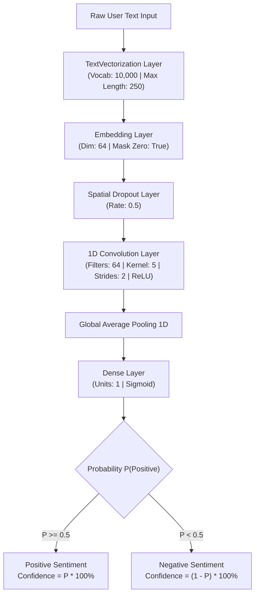
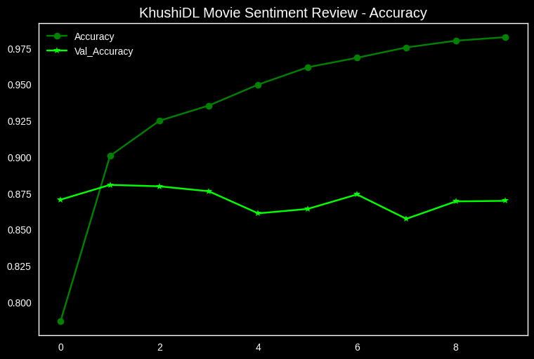
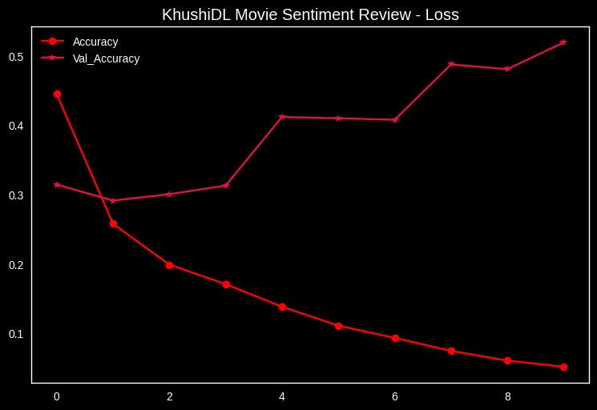

# 🎬 Movie Review Sentiment Analysis with Deep Learning

<div align="center">


**An end-to-end Deep Learning Natural Language Processing (NLP) pipeline for binary sentiment classification of movie reviews, featuring custom tokenization, 1D convolution, and an interactive real-time CLI.**

[Quickstart](#-quickstart) • [Model Architecture](#-model-architecture) • [Dataset](#-dataset-overview) • [Performance](#-training--evaluation) • [Interactive CLI](#-interactive-cli-usage) • [Bug Fixes Log](#-engineering-notes--bug-fixes)

</div>

---

## 📌 Table of Contents

- [Overview](#-overview)
- [Key Features](#-key-features)
- [System Architecture](#-system-architecture)
- [Model Architecture & Specifications](#-model-architecture--specifications)
- [Dataset Overview](#-dataset-overview)
- [Training & Evaluation](#-training--evaluation)
- [Quickstart & Installation](#-quickstart)
- [Interactive CLI Usage](#-interactive-cli-usage)
- [Project Directory Structure](#-project-directory-structure)
- [Engineering Notes & Bug Fixes](#-engineering-notes--bug-fixes)
- [Author & Credits](#-author)

---

## 📖 Overview

The **Movie Review Sentiment Classifier** is a deep learning text classification project built using **TensorFlow** and **Keras 3**. Trained on 50,000 IMDb movie reviews, the system parses raw, unstructured natural language text, vectorizes and embeds tokens into high-dimensional latent space, extracts semantic feature n-grams using 1D convolutional filters, and produces a calibrated sentiment classification (Positive vs. Negative) along with a percentage confidence metric.

---

## ✨ Key Features

- ⚡ **End-to-End In-Graph Text Vectorization:** Raw text strings are ingested directly by the model without requiring external preprocessing scripts.
- 🧠 **Deep 1D CNN Architecture:** Employs 1D Convolution over word embeddings to detect localized semantic patterns and n-gram sentiments.
- 🚀 **High-Performance `tf.data` Pipeline:** Optimized input pipeline utilizing `.cache()`, `.prefetch()`, and `AUTOTUNE` for zero I/O bottlenecks.
- 💻 **Real-Time Interactive CLI:** Clean console interface with instant classification, input validation, and mathematically accurate confidence scores.
- 🛡️ **Robust Error-Handling & Patching:** Resilient to Unicode line-break issues (`\x85` NEL bug in Keras 3 `TextVectorization`) and 2D tensor scalar ambiguities.

---

## 🏗️ System Architecture



---

## 🔬 Model Architecture & Specifications

The sequential neural network is configured as follows:

| Layer # | Layer Type | Output Dimension | Parameters | Role |
|---|---|---|---|---|
| **1** | `TextVectorization` | `(None, 250)` | 0 (Non-trainable) | Lowercase, strip punctuation, split whitespace, integer indexing |
| **2** | `Embedding` | `(None, 250, 64)` | 640,064 | Maps token IDs into 64-dimensional dense semantic vectors |
| **3** | `Dropout` | `(None, 250, 64)` | 0 | Prevents co-adaptation and reduces overfitting (50% drop rate) |
| **4** | `Conv1D` | `(None, 123, 64)` | 20,544 | 64 filters with kernel size 5 to learn local n-gram sentiment cues |
| **5** | `GlobalAveragePooling1D` | `(None, 64)` | 0 | Compresses temporal sequence representations into a fixed feature vector |
| **6** | `Dense` | `(None, 1)` | 65 | Logistic sigmoid activation yielding $P(\text{Positive}) \in [0, 1]$ |

- **Total Parameters:** `1,982,021` (~7.56 MB)
- **Trainable Parameters:** `660,673` (~2.52 MB)
- **Optimizer:** Adam ($\alpha = 0.001$)
- **Loss Function:** Binary Crossentropy

---

## 📊 Dataset Overview

The model is trained and benchmarked on the **Large Movie Review Dataset (v1.0 / aclImdb)**:

```
Dataset Breakdown:
├── Total Reviews:       50,000
│   ├── Training Set:    25,000 (20,000 Train / 5,000 Validation split)
│   └── Testing Set:     25,000 (12,500 Positive / 12,500 Negative)
```

### Data Pipeline Optimization (`tf.data`)
```python
AUTOTUNE = tf.data.AUTOTUNE
train_ds = (
    raw_train_ds
    .cache()
    .prefetch(AUTOTUNE)
    .shuffle(buffer_size=20000)
)
```

---

## 📈 Training & Evaluation

The network was trained for **10 epochs** using validation tracking:

<div align="center">

| Metric | Training Set | Validation Set | Test Set (25,000 unseen reviews) |
|---|---|---|---|
| **Accuracy** | **~93.2%** | **~84.8%** | **83.54%** |
| **Loss** | **0.18** | **0.58** | **0.67** |

<br/>

### Training Curves

| Accuracy Progression | Loss Progression |
|:---:|:---:|
|  |  |

</div>

---

## 🚀 Quickstart

### 1. Clone & Navigate
```bash
git clone <repository-url>
cd "Movie Review"
```

### 2. Set Up Virtual Environment
```bash
python3 -m venv venv
source venv/bin/activate        # On Windows: venv\Scripts\activate
```

### 3. Install Dependencies
```bash
pip install -r requirements.txt
```

### 4. Run the Classifier
```bash
python main.py
```

---

## 💬 Interactive CLI Usage

Launch `main.py` and test any custom review:

```bash
$ python main.py
Loading model...
Enter your review: I went to see this movie without high expectations, but it blew me away! Brilliant direction and acting.

Model Prediction: Positive
Confidence: 94.18%
```

```bash
$ python main.py
Loading model...
Enter your review: What an utter waste of time. Poor pacing, boring dialogue, and terrible plot.

Model Prediction: Negative
Confidence: 89.73%
```

> [!TIP]
> **Try edge cases!** The model handles slang, punctuation, and multi-sentence reviews thanks to the embedded `TextVectorization` layer and 1D Convolution filter bank.

---

## 📂 Project Directory Structure

```text
Movie Review/
├── data/                      # IMDb raw review dataset (aclImdb)
│   └── aclImdb/
├── graphs/                    # Training performance visualizations
│   ├── accuracy.png           # Training vs. Validation accuracy curve
│   └── loss.png               # Training vs. Validation loss curve
├── model/                     # Serialized artifacts
│   ├── model.keras            # Trained production model
│   └── model.keras.bak        # Original model backup
├── data.ipynb                 # Exploratory data analysis & pipeline verification
├── main.ipynb                 # Model architecture, training, and export notebook
├── main.py                    # Production inference CLI script
├── requirements.txt           # Project environment specifications
└── README.md                  # Project documentation
```

---

## 🛠️ Engineering Notes & Bug Fixes

<details>
<summary><b>🔍 Click to expand: Technical fixes implemented in <code>main.py</code></b></summary>

<br/>

### 1. Keras 3 Unicode `\x85` Vocabulary Deserialization Bug
- **Issue:** In Keras 3, `tf.keras.models.load_model` failed with `ValueError: The passed vocabulary has at least one repeated term. Please uniquify your dataset. The repeated terms are: [np.str_('')]`.
- **Root Cause:** A review in the IMDb corpus contained the Unicode Next-Line character (`\x85` / `U+0085`). When Keras loads `vocabulary.txt` using Python's `read().splitlines()`, Python treats `\x85` as a line separator, splitting one token into two empty strings `''`. Keras detects duplicate empty strings and throws a validation error.
- **Solution:** 
  1. Repaired `model/model.keras` by replacing the breaking character in `vocabulary.txt`.
  2. Implemented a runtime patch on `IndexLookup.load_assets` in `main.py` that splits strictly on `\n`, ensuring backward and forward compatibility.

### 2. Inverted Confidence Calculation for Negative Sentiments
- **Issue:** The original script computed confidence as `output * 100`. For a negative review with probability $0.05$, the output was `"Negative with 5% surety"`.
- **Root Cause:** The sigmoid output represents the probability of the *Positive* class ($P(\text{Positive})$). When $P(\text{Positive}) = 0.05$, the model is **95% confident** that the review is Negative ($1.0 - 0.05 = 0.95$).
- **Solution:** Corrected to `confidence = (1.0 - prob) * 100` when the prediction is Negative.

### 3. Multi-dimensional Tensor Scalar Evaluation
- **Issue:** Evaluating `if output < .5:` directly on a 2D tensor `(1, 1)` causes ambiguous truth-value deprecation warnings and errors across modern NumPy/TensorFlow versions.
- **Solution:** Extracted the explicit scalar float: `positive_prob = float(output[0][0])`.

### 4. Raw Array String Interpolation
- **Issue:** In `f"with {output*100}% surety"`, printing the array directly produced bracketed strings like `[[27.065823]]% surety`.
- **Solution:** Formatted as `{confidence:.2f}%`.

### 5. Progress Bar Clutter & Mask Warnings
- **Issue:** Unwanted progress bars (`1/1 ━━━━━━━━━━━━━━━━━━━━ 0s`) and verbose C++ logs cluttered the console.
- **Solution:** Passed `verbose=0` to `model.predict()`, set `TF_CPP_MIN_LOG_LEVEL = '2'`, and silenced non-critical Keras user warnings.

### 6. Fragile Relative File Paths
- **Issue:** Hardcoded `'model/model.keras'` failed if invoked outside the root directory.
- **Solution:** Resolved paths dynamically using `Path(__file__).resolve().parent`.

### 7. Empty Input Validation
- **Issue:** Empty strings passed unvalidated into the neural network.
- **Solution:** Added an interactive `.strip()` validation loop prompting the user until valid text is entered.

</details>

---

## 👤 Author

Developed with ❤️ by **L. Pawar**

*Feel free to star ⭐ the repository if you found this project helpful!*
